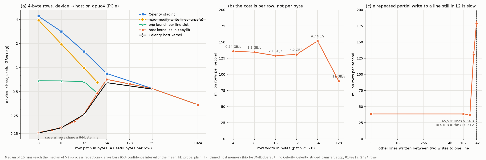
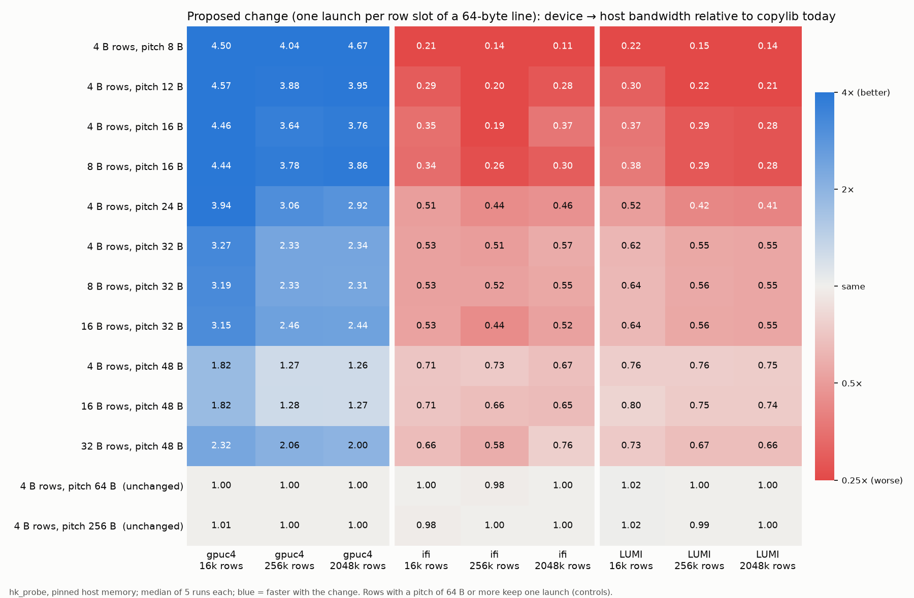

**Goal:** Why the host kernel is slow on gpuc4, and a proposed fix checked on all systems (plain HIP probe, no Celerity).

**Result:** Partial-line writes over PCIe are bound by the transaction rate; one launch per row slot helps gpuc4 1.3-4.7x but costs 0.11-0.80x on ifi and LUMI, so the fix was rejected.

---

# Why the host kernel is slow on gpuc4

`COPYLIB_HOST_KERNEL=1` collapses on gpuc4 (RX 9060 XT, gfx1200, PCIe). For example, device→host of 4-byte rows at an 8-byte pitch runs at 0.15 GB/s, while staging reaches 4.4 GB/s. This study narrows down when that happens and why, using a plain HIP program (`hk_probe.hip`, without Celerity or copylib) and the real Celerity stack side by side. Measured on 2026-10-04, build `014e21a`.



## Result

The slowdown is a property of the GPU and the PCIe write path, not of copylib. copylib's host kernel runs exactly at the hardware ceiling for its access order: Celerity's host kernel and `hk_probe` agree within 1–2% (9% at a 64-byte pitch).

1. **Device→host writes cost one transaction per row.**
   - At a 256-byte pitch, the GPU writes about 135 M rows/s whether a row is 4, 8, 16 or 32 bytes wide. Bandwidth is therefore about row width × 135 M/s: 0.54 GB/s for 4-byte rows, 4.2 GB/s for 32-byte rows.
   - The link limit (11.5 GB/s) is reached only at 128-byte rows.
   - With one row per 64-byte line, the rate peaks at 178 M rows/s (64-byte pitch). It drops for larger pitches (136 M at 256 B, 86 M at 1 KiB), which is consistent with address-translation cost.
2. **Several rows in one 64-byte line make it up to 4.6× worse.**
   - With copylib's order (consecutive threads take consecutive rows), the rate drops to 66 M rows/s with 2 rows per line, 45 M with 4 and 39 M with 8. This holds for every row width tested: 4, 8 and 16 bytes.
   - The cause is a second partial write to a line that the same kernel partially wrote not long before. It is slow (about 26 ns instead of 5.6 ns) as long as fewer than about 32,768 other lines were written in between. From 65,536 on it is fast again; 49,152 is in between. 65,536 lines × 64 B = 4 MiB, the size of the GPU's L2 cache.
   - A kernel boundary resets this: splitting the copy into one launch per row slot of a line is fast even for 16k-row copies.
   - Work-group size, elements per thread, host allocation flags (default, coherent, non-coherent, write-combined, registered) and non-temporal stores made no difference. These were exploratory runs with 1–2 repetitions each.
3. **Host→device reads are bound by the link, not by this effect.**
   - Every row costs at least a whole 64-byte line. Up to a 128-byte pitch the reads run at the link limit: 6.9 GB/s useful at an 8-byte pitch, 0.81 at 64.
   - From a 256-byte pitch on, the GPU sustains only about 46 M reads/s (36 M at 1 KiB).
   - This is why staging wins host→device for sparse 4-byte rows, but by a moderate factor, not by a collapse.

## What can be done in the host kernel (code ideas; untested in copylib)

| Device→host, useful GB/s | 4 B rows, pitch 8 | pitch 16 | pitch 32 | pitch 48 | 16 B rows, pitch 32 |
|---|---|---|---|---|---|
| copylib's order (= Celerity host kernel) | 0.155 | 0.179 | 0.263 | 0.478 | 1.05 |
| one launch per row slot of a line (`phase`) | 0.684 (4.4×) | 0.682 (3.8×) | 0.669 (2.5×) | 0.478 | 2.81 (2.7×) |
| read-modify-write whole 16-byte pieces (`rmw`, **unsafe**) | 3.92 (25×) | 1.97 (11×) | 0.99 | 0.66 | 4.00 |
| Celerity staging (worker-sweep config) | 4.37 | 2.83 | 1.59 | – | – |

- **`phase`:** issue one kernel per row slot of a line (64 / pitch launches, or reorder so that rows sharing a line are written more than 4 MiB of lines apart). It is safe. For narrow rows it still stays far below staging, because the per-row transaction cost of point 1 remains.
- **`rmw`:** read the host lines, merge the row bytes in, and write whole pieces. This is close to staging, but it also writes back the gap bytes. That breaks as soon as anything else writes those gaps concurrently, for example another chunk of the same copy (chunk boundaries share lines), another copy, or a host task. It isn't usable without guaranteeing exclusive lines.
- **Overall:** on PCIe, device→host with rows narrower than about 32–64 bytes belongs to staging. The host kernel wins device→host only for wide rows (it is link-bound from 64-byte rows on), and loses host→device for 4-byte rows at any pitch of 16 bytes or more. This supports the per-direction and per-row-width switch idea.

### The minimal copylib diff (rejected 2026-10-05 as too device-specific, not applied; kept for reference; `src/backend_kernels.cpp`, `copy_with_kernel_impl`)

```diff
 	const sycl::nd_range<1> ndr{(static_cast<size_t>(extent) + wg_size * per_item - 1) / (wg_size * per_item) * wg_size, wg_size};
-	return q.parallel_for(ndr, [=](sycl::nd_item<1> idx) {
-		for(IdxType n = 0, i = idx.get_group(0) * wg_size * per_item + idx.get_local_id(0); n < per_item && i < extent; n++, i += wg_size) {
-			tgt[tgt_layout.offset_at(tgt_start + i)] = src[src_layout.offset_at(src_start + i)];
-		}
-	});
+	// Device -> host with several target rows per 64-byte line: on PCIe GPUs a partial write to a host line that the same kernel
+	// wrote shortly before is slow (gfx1200: ~26 instead of ~6 ns, benchmarks/hk_probe), so the rows sharing a line are written by
+	// separate launches, each taking every slots-th target row. slots = the most rows that can touch one 64-byte line.
+	const int64_t pitch = spec.target_layout.d0_stride;
+	const int64_t width = spec.target_layout.d0_end_offset - spec.target_layout.d0_start_offset;
+	const IdxType slots = spec.target_device == device_id::host && width < pitch && pitch < 64 ? (62 + width) / pitch + 1 : 1;
+	sycl::event last;
+	for(IdxType slot = 0; slot < slots; ++slot) {
+		const auto kernel = [=](sycl::nd_item<1> idx) {
+			for(IdxType n = 0, i = idx.get_group(0) * wg_size * per_item + idx.get_local_id(0); n < per_item && i < extent; n++, i += wg_size) {
+				if(slots > 1 && (tgt_start + i) / tgt_layout.row_extent % slots != slot) continue;
+				tgt[tgt_layout.offset_at(tgt_start + i)] = src[src_layout.offset_at(src_start + i)];
+			}
+		};
+		last = slot == 0 ? q.parallel_for(ndr, kernel) : q.parallel_for(ndr, last, kernel); // in sequence, also on out-of-order queues
+	}
+	return last;
```

- **Only applies to host targets** with rows narrower than their pitch and a pitch under 64 B. Every other copy keeps `slots = 1`, so it launches exactly as before.
- **Launches are chained:** each depends on the previous one. Without that, an out-of-order queue would let the caller see only the last launch finish, and overlapping launches would write the same lines again.
- **Must be an opt-in:** the slots check below shows it slows ifi and LUMI down. Gate `slots > 1` behind an env switch, for example `COPYLIB_HOST_WRITE_SLOTS=1`, default off.

## Check of the proposed change on all three systems (`slots`)

The proposed copylib diff writes device→host copies with rows narrower than their pitch and a pitch under 64 bytes in `(62 + S) / P + 1` launches, each writing only the rows of one slot. `hk_probe` reproduces that launch pattern exactly (order `filter`). It was compared with copylib today (`natural`) and the compact variant (`phase`) on 11 affected shapes plus 2 controls (pitch 64 and 256 B), at 16k, 256k and 2M rows, with 5 runs each. That is 1755 runs on gpuc4, ifi (gc20, job 1705986) and LUMI (GCD 4, job 22537826, 0.5 GPU-h), and all passed their check. Generator: `make_slots_yamls.py`; jobs: `job_slots_{ifi,lumi}.sbatch`; analysis: `analyze_slots.py`, which writes `results/slots_summary.csv` and `results/slots.png`.



| Affected cases (33 per system) | gpuc4 | ifi | LUMI |
|---|---|---|---|
| Change relative to today | **1.26–4.67× faster** | **0.11–0.76× (slower)** | **0.14–0.80× (slower)** |
| Example: 4 B rows, pitch 8, 2M rows | 0.155 → 0.72 GB/s | 170 → 19 GB/s | 8.8 → 1.25 GB/s |

- **gpuc4 gains in every affected case** and is unchanged in the controls. For pitches that don't divide 64 (24, 48 B), `filter` also beats `phase`, because its slot count covers rows that straddle a line.
- **ifi and LUMI lose in every affected case.** The more rows share a line, the bigger the loss. Their GPUs evidently merge the writes of several rows to one line inside a kernel, which is exactly what the change prevents: every row becomes its own write.
- **The controls are unchanged on all systems** (0.98–1.02). The change touches nothing else.
- ifi's absolute numbers at 256k rows (up to 320 GB/s) are cache effects of the APU's shared memory; the ratios are what matter here.

**Consequence:** the change must not be unconditional. It belongs behind an opt-in, for example an env switch `COPYLIB_HOST_WRITE_SLOTS=1` that defaults off, or a check that only enables it for discrete PCIe GPUs of gpuc4's kind (which other GPUs behave like gfx1200 is untested). Even on gpuc4, staging stays ahead for 4-byte rows (4.4 vs 0.72 GB/s at pitch 8), so the larger lever there remains the per-direction or per-row-width switch between staging and the host kernel.

## Not covered

- The root-cause probes ran on gpuc4 only; ifi and LUMI were only probed for the proposed change (section above).
- The L2 explanation rests on the window size and the effect of kernel boundaries, not on hardware counters.
- The exploratory runs used 1–2 repetitions. Only the final study below has 10 runs per configuration.

## Files and reproduction

- `hk_probe.hip`: the probe. Its usage is in the file header; every run checks all row bytes and that all gap bytes are unchanged.
- `make_hk_probe_yamls.py` writes `gpuc4_hk_probe.yaml`: 73 configurations, 10 runs + 1 warmup, run through the unchanged `benchmark_wrapper.py` in about 6 minutes.
- `results/gpuc4_hk_probe.csv` (one row per run; all 730 runs passed their check), `results/summary.csv` (median, 95% CI, CV per configuration), `results/hk_probe.png`.
- On gpuc4, in `~/finalizing-work/benchmarks`:

  ```sh
  /opt/rocm-7.1.0/bin/hipcc -O3 --offload-arch=gfx1200 13_hk_probe/hk_probe.hip -o 13_hk_probe/hk_probe
  python3 -u benchmark_wrapper.py 13_hk_probe/gpuc4_hk_probe.yaml
  ```

  Then, locally: `python3 13_hk_probe/analyze_hk_probe.py`.
